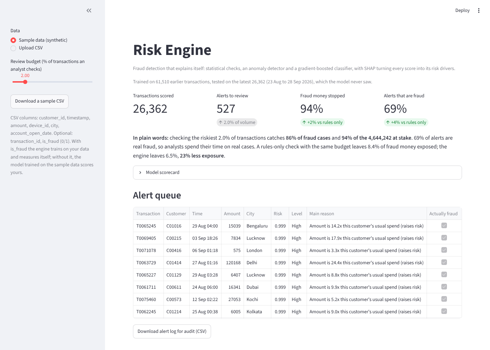

# Risk Engine


A fraud detector that explains itself, so the people who act on an alert can see why it fired.



## How it works

Every transaction is compared with the customer's own earlier activity, never with later data:

| Signal | Meaning |
|---|---|
| Amount vs. history | Amount ÷ the customer's median earlier spend |
| New device | First time this device appears on the account |
| Login location | First transaction from this city |
| Account age | Days since the account was opened |
| Time of day | Between midnight and 5 am |
| Activity in last 24h | Other transactions in the previous 24 hours |

These signals feed three layers:

1. **Statistical checks:** five classic red flags (amount 5x or more above normal, new device, new city, account under 90 days old, night-time), counted per transaction.
2. **Anomaly detector:** an Isolation Forest trained only on legitimate transactions scores how unusual each one looks.
3. **Classifier:** XGBoost combines the raw signals with both layers above into a fraud probability.

SHAP then breaks each score into its risk drivers. The app writes them in plain words, for example
"Amount is 14.2x this customer's usual spend (raises risk)" or "Account is 2,100 days old (lowers risk)".

## What you see

- **Headline:** with a review budget (default: the riskiest 2% of transactions), how many fraud cases and how
  much fraud money the alerts catch, and how many alerts are real fraud. All of it is compared with a
  rules-only check given the same budget.
- **Alert queue:** every alert with its risk level and main reason.
- **Why it fired:** pick an alert to see its drivers as a chart and in words, plus what each layer said.
- **Audit log:** download every alert with its top three reasons and rule hits as a CSV.

All figures are measured on a held-out window. The model trains on the earlier 70% of the timeline and is tested
on the latest 30%, as it would run in production. On the bundled synthetic data it catches about 86% of
fraud cases and 94% of the money at stake, leaving about 23% less fraud money exposed than rules alone.
These figures come from synthetic data, not a real deployment.

## Your own data

Upload a CSV with `customer_id, timestamp, amount, device_id, city, account_open_date` and, optionally,
`transaction_id` and `is_fraud` (0/1). The sidebar has a sample file to download.

- **With labels** (at least 20 fraud cases): the engine trains on your data and measures itself on your latest 30%.
- **Without labels:** the model trained on the synthetic data scores every transaction. There are no
  accuracy figures, since there is nothing to check against.

## Run it

macOS: double-click `run_app.command`. Anywhere else:

```bash
python3 -m venv .venv
.venv/bin/pip install -r requirements.txt
.venv/bin/streamlit run app.py
```

`python model_engine.py` runs a self-check: a feature unit test, then a full train and test on synthetic data.
`python data_gen.py` writes the sample data to `data/sample_transactions.csv`.

## Files

- `app.py`: Streamlit dashboard
- `model_engine.py`: features, the three layers, SHAP explanations, evaluation
- `data_gen.py`: synthetic transactions with labelled account-takeover fraud
